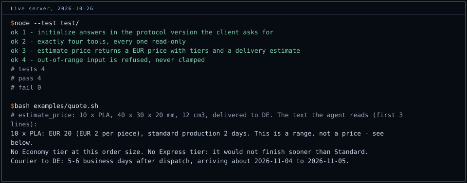

# 3Descu quote MCP server

[](https://github.com/cadi27tech/3descu-mcp-quote/actions/workflows/smoke.yml)

A public Model Context Protocol server that lets an AI assistant (Claude, ChatGPT, any MCP client) price real 3D-printed parts from a working factory: 3Descu, an ISO 9001:2015 certified company in Romania with 200+ FDM and SLA printers, shipping across the EU.

The price an agent gets is the price the public calculator at [quote.3descu.com](https://quote.3descu.com) gives, from the same pricing engine. It is not a rate card that can drift.

- **Registry:** official MCP Registry, `io.github.cadi27tech/3descu-quote` ([registry entry](https://registry.modelcontextprotocol.io/v0/servers?search=3descu)), active since 18 Oct 2026
- **Endpoint:** `https://zzamnvhadwibvafqcfpd.supabase.co/functions/v1/mcp` (streamable HTTP, JSON-RPC 2.0)
- **Branded alias:** `https://quote.3descu.com/api/mcp`, a proxy to the same server
- **Auth:** none. No key, no account, no data written.
- **Protocol versions:** `2025-06-18` (default), `2025-03-26`, `2024-11-05`, answered in the version the client asks for

This repo is the public case study and connection guide. The server itself lives in the private 3Descu platform repo, because it imports the production pricing engine directly.

<picture>
  <source media="(max-width: 600px)" srcset="docs/architecture-m.svg">
  
</picture>

## Tools

All four are read-only (`readOnlyHint: true`). None creates an order, charges anything or stores a row.

| Tool | What it does | Per-IP limit |
|---|---|---|
| `get_capabilities` | Technologies, build volumes, layer heights, accepted file formats, production tiers, minimum order. Call it first if feasibility is unknown. | global bucket only |
| `list_materials` | FDM and SLA materials with density and typical use; returns the `material_id` that `estimate_price` expects. | global bucket only |
| `analyze_model` | Downloads a public `.stl` or `.obj` from an allowlisted host (Printables, Thingiverse, GitHub, Google Drive, Dropbox, OneDrive, GrabCAD, Onshape and others) and measures volume, bounding box, surface area, triangle count and watertightness. | 20/hour |
| `estimate_price` | EUR price across economy, standard and express tiers, per piece and total, with production days and an optional courier transit estimate by destination country. | 120/hour |

On top of the per-tool limits there is a global bucket of 300 calls/hour per IP, plus server-wide caps, so an expensive tool cannot be funded from a cheap one's budget.

## Connect

**Claude Code**

```bash
claude mcp add --transport http 3descu-quote https://zzamnvhadwibvafqcfpd.supabase.co/functions/v1/mcp
```

**Claude (web and desktop):** Settings, Connectors, add a custom connector with the endpoint URL above. No authentication.

**ChatGPT:** enable developer mode for apps/connectors in Settings, create a connector with the endpoint URL, authentication none.

**Any client or plain HTTP:** see [`examples/quote.sh`](examples/quote.sh), which runs `initialize` and one `estimate_price` call with curl.

Then ask, for example: *"What would 50 PETG brackets, 60 x 40 x 15 mm, about 18 cm3 each, cost delivered to Germany?"*

## Design decisions

**A range when the data is incomplete, a price when it is not.** Material use depends on surface area (the printed shell), not just volume. Given only a bounding box and a volume, the honest answer is a bracket: the low end assumes a compact block, the high end a thin-walled part of the same volume. The response says which one it is. The bracket was checked against measured meshes that land exactly on the floor (a calibration cube), exactly on the ceiling (a thin-walled part) and inside it (a large adapter). `analyze_model` closes the gap by measuring the mesh with the same parser the browser uses.

**Refuse, never clamp.** A request for 300% infill gets an error, not a silent 100%. An agent handed a clamped answer repeats it as the answer to the question it asked.

**The cost base cannot leak by accident.** Responses are built by naming every field, never by spreading the engine result. Internal fields are split into "publishable" and "barred" lists, and a checker asserts the two lists partition every key the engine returns. A new internal field fails the build until someone decides which side it belongs on. Several fields are barred not because they are secret alone but because a pair of them back-solves a margin or a machine-hour rate.

**SSRF hardening on the one outbound fetch.** https only; host suffix match anchored with a leading dot (so `evilgithub.com` does not pass as `github.com`); URLs with credentials refused; redirects followed manually with every hop re-checked against the allowlist; bounded hops, 15 s timeout, 25 MB cap measured on the body rather than trusted from the header.

**Quote creation deliberately not exposed.** Reading a price is safe to hand an agent. Placing an order in a named customer's account is not, so every response points the agent to quote.3descu.com to order.

## Verification



`test/smoke.test.mjs` runs against the live public endpoint on every push and once a day: all three protocol versions, exactly four tools and every one read-only, a real EUR price with tiers and a delivery estimate, and an out-of-range input refused rather than clamped. Node 20+, no dependencies: `node --test test/`.

A dedicated checker runs on every release of the platform: deployment posture, redaction, validation, the SSRF guard, the price bracket, tier ordering and the protocol itself. The protocol section calls the handler instead of searching the source, because a mutation run showed that a grep-based checker could not tell a wrong JSON-RPC error code from a right one. A mutation harness breaks 52 things one at a time; 51 are caught, and the remaining one is unreachable through validated input.

## Distribution

Listed in the official MCP Registry and Glama, and added to community directories through merged pull requests:

- [TensorBlock/awesome-mcp-servers #4125](https://github.com/TensorBlock/awesome-mcp-servers/pull/4125)
- [mcpHQ/awesome-mcp-servers #325](https://github.com/mcpHQ/awesome-mcp-servers/pull/325)
- [punkpeye/awesome-remote-mcp-servers #2201](https://github.com/punkpeye/awesome-remote-mcp-servers/pull/2201)
- [toolsdk-ai/toolsdk-mcp-registry #930](https://github.com/toolsdk-ai/toolsdk-mcp-registry/pull/930)

## Press

The AI quoting channel was covered by [3D Printing Industry](https://3dprintingindustry.com/news/3descu-enables-3d-printing-quotes-through-chatgpt-and-claude-255887/), [3Druck.com](https://3druck.com/en/programs/3descu-integrates-ki-based-pricing-calculations-for-3d-printing-into-chatgpt-and-claude-02164231/) (EN, DE, FR) and [Romania Journal](https://www.romaniajournal.ro/business/companies/romanian-factory-3descu-opens-its-3d-printing-quotes-to-ai-assistants/) in October 2026.

## Stack

Supabase Edge Functions (Deno, TypeScript), streamable HTTP transport, Postgres-backed rate limiting, the production 3Descu pricing engine and mesh parser shared with the React front end.

Built by [Adrian Capraru](https://github.com/cadi27tech), founder of 3Descu.

The example script and the smoke test are MIT licensed ([LICENSE](LICENSE)). The server code is not published: it imports the production pricing engine.
